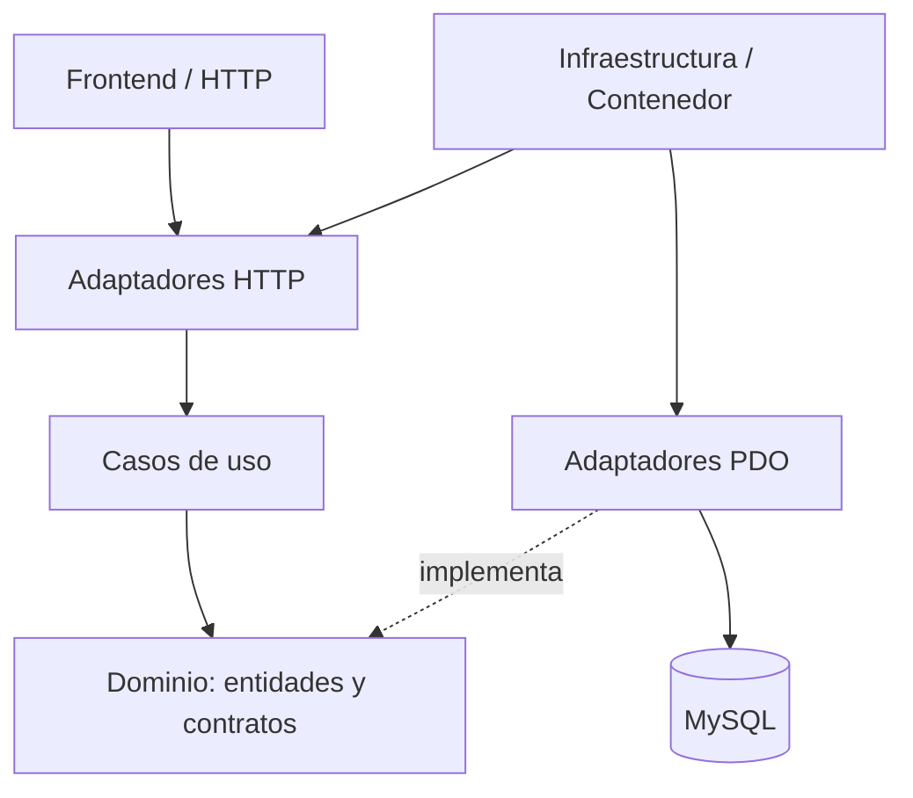

# Restaurante Institucional "Rumbo al Cielo"
## Sistema de Reservas de Almuerzos — Unión Boliviana

---

### Requisitos

| Componente | Versión mínima |
|---|---|
| PHP | 8.0+ |
| MySQL / MariaDB | 8.0 / 10.5 |
| Apache | 2.4 (con mod_rewrite) |
| phpMyAdmin | Cualquier versión reciente |

XAMPP / WAMP / Laragon son válidos para entorno local.

---

### Instalación Rápida

1. **Copiar el proyecto** en `htdocs/` (XAMPP) o `www/` (WAMP).
2. **Crear o actualizar la base de datos** en phpMyAdmin:
   - Instalación nueva: importar `database/restaurante_rumbo_al_cielo.sql`.
   - Instalación existente: hacer una copia de seguridad y ejecutar `database/restaurante_rumbo_al_cielo.sql` (no importar el schema encima de una base ya creada).
   - La BD se llama `restaurante_rumbo_al_cielo`.
3. **Configurar credenciales** en `backend/config/database.php`:
   ```php
   define('DB_HOST', 'localhost');
   define('DB_USER', 'root');
   define('DB_PASS', '');       // Cambia si tu MySQL tiene contraseña
   ```
4. **(Opcional)** Programar `backend/cron/cerrar_reservas.php` (solo CLI) después de la hora límite. Si no se programa, cocina y reportes aplican el corte igualmente.
5. **Acceder** en el navegador: `http://localhost/Sistema%20Restaurante%20F/`

---

### Credenciales por Defecto

| Rol | Correo | Contraseña |
|---|---|---|
| Administrador | admin@rumboalcielo.bo | (contraseña inicial entregada aparte) |

> ⚠ Cambia la contraseña del admin al primer inicio de sesión.

---

### Estructura del Proyecto

```
/
├── index.php                  ← Login / entry point
├── .htaccess                  ← Seguridad Apache
├── database/
│   └── schema.sql             ← Script SQL completo
├── backend/
│   ├── config/
│   │   ├── database.php       ← Conexión PDO + constantes
│   │   └── session.php        ← Gestión de sesiones y roles
│   ├── models/                ← Capa de datos (PDO queries)
│   │   ├── Usuario.php
│   │   ├── Familiar.php
│   │   ├── Calendario.php
│   │   ├── Menu.php
│   │   ├── Reserva.php
│   │   └── Reporte.php
│   ├── controllers/           ← Lógica de negocio
│   │   ├── AuthController.php
│   │   ├── EmpleadoController.php
│   │   ├── FamiliarController.php
│   │   ├── MenuController.php
│   │   ├── CalendarioController.php
│   │   ├── ReservaController.php
│   │   └── ReporteController.php
│   └── api/                   ← Endpoints JSON (AJAX)
│       ├── auth.php
│       ├── empleados.php
│       ├── familiares.php
│       ├── menus.php
│       ├── calendario.php
│       ├── reservas.php
│       └── reportes.php
└── frontend/
    ├── assets/
    │   ├── css/main.css       ← Estilos globales
    │   └── js/app.js          ← Utilidades JS (fetch, toast, modales)
    ├── admin/                 ← Panel Administrador
    │   ├── layout.php / layout_end.php
    │   ├── dashboard.php
    │   ├── empleados.php
    │   ├── familiares.php
    │   ├── menus.php
    │   ├── calendario.php
    │   ├── reservas.php
    │   └── reportes.php
    └── empleado/              ← Panel Empleado (titular)
        ├── layout.php / layout_end.php
        ├── dashboard.php
        ├── menu.php
        ├── reservas.php
        └── familiares.php
```

---

### Funcionalidades añadidas según Product Backlog

| Historia / regla | Implementación |
|---|---|
| Acceso por correo o CI y bloqueo de cuentas inactivas | `AuthController` + `Usuario::findByEmail()` |
| Registro con apellido, CI y departamento | `EmpleadoController` + `usuarios` |
| Familiares de primer grado con CI y parentesco | `FamiliarController` + tabla `familiares` |
| Inscripción mensual y reservas automáticas de L-J | `backend/api/pension.php` + `inscripciones_pension` |
| Solicitud esporádica por WhatsApp registrada por admin | `reservas.php` + `ReservaController::registrarEsporadicaAdmin()` |
| Cocina: corte diario y marcado de raciones entregadas | `backend/api/cocina.php` + `frontend/admin/cocina.php` |
| Parámetros de hora, tarifas y mínimo | `backend/api/configuracion.php` + `configuracion_sistema` |
| Menú semanal separado en sopa, plato principal y postre | `backend/api/guardar_menus.php` + columnas de `menus` |
| Días operativos: L-J | `Calendario::esDiaOperativo()` — verifica `date('N')` 1..4 |
| Bloqueo cancelación 09:00 | `ReservaController::cancelar()` compara hora del servidor |
| Pensionado: 15 Bs, mínimo mensual configurable de almuerzos | `ReporteController` y `configuracion_sistema` |
| No pensionado: 18 Bs, sin mínimo | `ReporteController::generarReporteMensual()` |
| Cobro familiar al código del titular | Tabla `reportes_mensuales` consolida por `codigo_empleado` |
| Feriados solo por admin; se cancelan reservas del día | `CalendarioController::marcarFeriado()` + `requireRole('ADMIN')` |
| Familiares sin acceso independiente | Los familiares no tienen usuario; el titular pensionado los registra y administra |

---

### Corte automático de inasistencias (09:00 AM)

Para que el sistema marque las reservas no canceladas como `INASISTENCIA` exactamente después de la hora límite, configura una tarea diaria que ejecute `php backend/cron/cerrar_reservas.php` a las 09:01 AM (hora de Bolivia). En Linux puede programarse en cron; en Windows, mediante el Programador de tareas. El módulo de cocina también ejecuta el corte como respaldo cuando consulta el consolidado.

### Configuración del correo de recuperación

La solicitud se guarda en `solicitudes_recuperacion` y el sistema intenta notificar a `admin@rumboalcielo.bo` mediante `mail()` de PHP. Para que llegue al buzón, el servidor debe tener SMTP/sendmail configurado. Por seguridad, el sistema no envía contraseñas existentes por correo: el administrador debe restablecer el acceso.

### Tarifas de Referencia

- **No Pensionado:** Bs 18 por almuerzo consumido (sin mínimo)
- **Pensionado / Familiar:** Bs 15 por almuerzo
  - Mínimo 10 almuerzos/mes
  - Si consume < 10: se cobra igual `10 × 15 = Bs 150`
  - Ejemplo: 7 consumidos → `7×15 + 3×15 = Bs 150`

---

### Reporte Mensual para RRHH

1. Ir a **Admin → Reporte Mensual**
2. Seleccionar mes y año
3. Clic en **"Calcular y Generar"**
4. Descargar como **CSV** o **Imprimir**

El reporte incluye por cada código de empleado:
- Almuerzos consumidos (titular + familiares)
- Monto base + penalización por incumplimiento
- **Total a descontar en planilla**

---

## Arquitectura limpia (los siete módulos)

El proyecto incluye las capas de dominio, aplicación, adaptadores e infraestructura para los siete módulos: Usuarios, Familiares, Pensiones, Platos, Menú, Reservas y Reportes. Cada módulo tiene su entidad de dominio; los seis módulos distintos de Platos tienen casos de uso de guardar/actualizar, listar, obtener y eliminar. Platos conserva casos de uso específicos para registrar, modificar, activar y desactivar.



| Capa | Ubicación | Responsabilidad |
|---|---|---|
| Dominio | `src/Domain/` | Entidades y reglas de validación sin PDO ni framework. |
| Aplicación | `src/Application/` | Casos de uso por módulo. |
| Adaptadores | `src/Adapters/Http/`, `src/Adapters/Persistence/` | Controladores y repositorios PDO. |
| Infraestructura | `src/Infrastructure/` | `Contenedor.php`, composición de dependencias. |
| Pruebas | `tests/` | Pruebas de aplicación y prueba rápida independiente. |

El mapeo de entidades a tablas, la API de casos de uso, los permisos y las restricciones de trazabilidad están documentados en `docs/ARQUITECTURA_LIMPIA.md`. La API limpia está disponible en `backend/api/arquitectura.php` y usa `Contenedor::moduloController()` para componer cada módulo.

**Compatibilidad:** se mantienen los endpoints históricos y controladores especializados para no romper las pantallas ni las reglas operativas ya existentes. Las operaciones de negocio con reglas específicas (inscripción mensual, reservas automáticas, cancelación, cocina y cálculo de reportes) deben seguir ejecutándose por sus flujos especializados; no se permite sustituirlas por borrados o CRUD genéricos. La migración final de las pantallas a los casos de uso nuevos requiere probar los flujos con la base de datos local.

### Pruebas

Ejecutar `php tests/run_smoke.php` para una comprobación rápida sin MySQL. Para la suite PHPUnit: `composer install` y luego `composer test`. La integración real debe verificarse en XAMPP con la base `restaurante_rumbo_al_cielo`.
