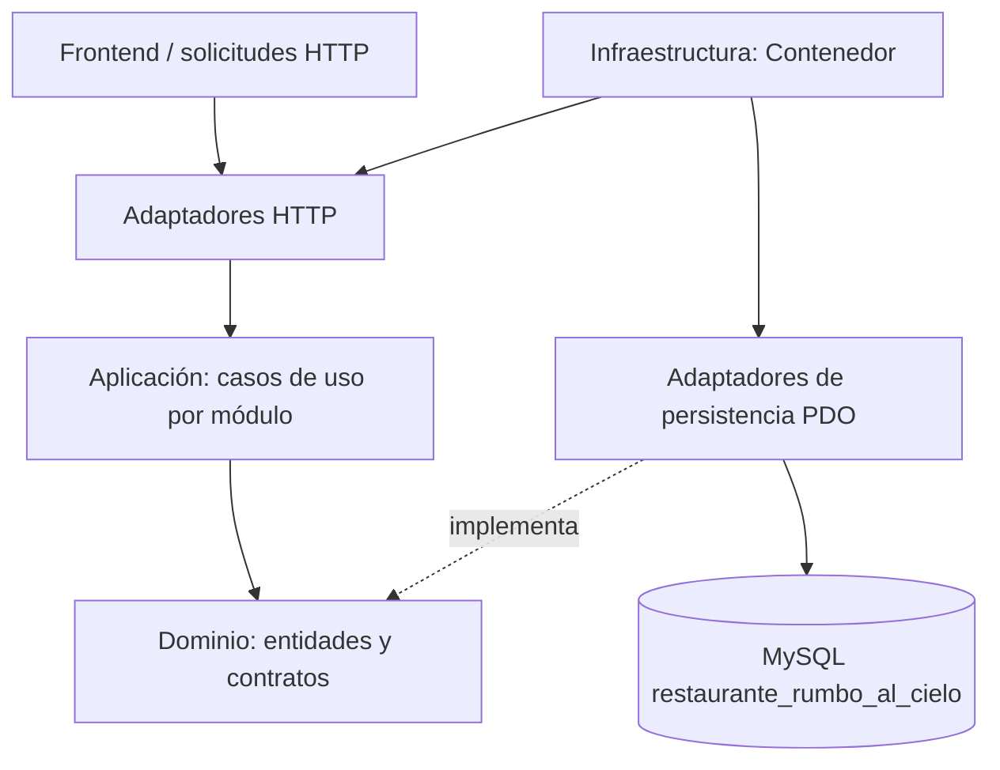

# Arquitectura limpia — Rumbo al Cielo

## Alcance

La solución organiza los siete módulos funcionales en cuatro capas. Platos conserva sus casos de uso especializados; Usuarios, Familiares, Pensiones, Menú, Reservas y Reportes disponen de entidades, casos de uso de registrar/actualizar, listar, obtener y eliminar (el borrado físico se restringe para registros que requieren trazabilidad), un puerto de repositorio común y un adaptador PDO configurado desde la raíz de composición.

## Diagrama

## Carpetas

| Capa | Carpeta | Contenido |
|---|---|---|
| Dominio | `src/Domain/` | Entidades, validaciones e interfaces de repositorio; no importa PDO ni HTTP. |
| Aplicación | `src/Application/` | Casos de uso `Guardar`, `Listar`, `Obtener` y `Eliminar` por módulo, además de los casos específicos de Platos. |
| Adaptadores de entrada | `src/Adapters/Http/` | Controladores que convierten solicitudes en llamadas a casos de uso y respuestas JSON. |
| Adaptadores de salida | `src/Adapters/Persistence/` | Implementaciones PDO de los contratos del dominio. |
| Infraestructura | `src/Infrastructure/` | `Contenedor`, único lugar que conecta base de datos, repositorios, casos de uso y controladores. |
| Pruebas | `tests/` | Pruebas PHPUnit y prueba ejecutable sin dependencias externas. |

## Mapeo a la base de datos

| Módulo | Entidad | Tabla |
|---|---|---|
| Usuarios | `Domain/Usuario/Usuario.php` | `usuarios` |
| Familiares | `Domain/Familiar/Familiar.php` | `familiares` |
| Pensiones | `Domain/Pension/Pension.php` | `inscripciones_pension` |
| Platos | `Domain/Plato/Plato.php` | `platos` |
| Menú | `Domain/Menu/Menu.php` | `menus` |
| Reservas | `Domain/Reserva/Reserva.php` | `reservas` |
| Reportes | `Domain/Reporte/Reporte.php` | `reportes_mensuales` |

## Composición

`Contenedor::platoController()` construye el módulo Platos con sus casos de uso específicos.

`Contenedor::moduloController()` recibe `usuarios`, `familiares`, `pensiones`, `menus`, `reservas` o `reportes`, crea el adaptador PDO con una lista blanca de tablas/columnas y compone los casos de uso de ese módulo.

Las consultas usan parámetros preparados. Los nombres de tabla y columnas no vienen de la petición HTTP, sino de una configuración fija en el contenedor. El controlador no devuelve el campo `contrasena`; el caso de uso de Usuario convierte contraseñas en texto plano a hash antes de persistirlas.

## API de la capa limpia

Se agregó `backend/api/arquitectura.php` para ejecutar los casos de uso desde HTTP:

- `GET arquitectura.php?modulo=usuarios&accion=listar`
- `GET arquitectura.php?modulo=familiares&accion=obtener&id=1`
- `POST arquitectura.php` con `modulo=menus`, `accion=guardar` y los campos del menú.
- `POST arquitectura.php` con `modulo=reservas`, `accion=guardar` y los campos de la reserva.

Los permisos se verifican por módulo y se impide el borrado físico genérico de pensiones, reservas y reportes para preservar trazabilidad. Las reglas específicas de inscripción mensual, cancelación por hora límite, corte de cocina, publicación de menú y cálculo de descuentos deben ejecutarse mediante sus operaciones de negocio existentes, no mediante CRUD genérico.

## Compatibilidad y validación pendiente

Los endpoints históricos `backend/api/*.php` y los controladores especializados se conservan para no romper los formularios y las reglas del sistema que ya estaban implementadas. El nuevo adaptador HTTP expone los casos de uso de la arquitectura limpia; la sustitución total de cada operación especializada del frontend debe hacerse de forma controlada y validando los flujos reales contra la base de datos local.

No se afirma una prueba de integración contra MySQL en este paquete: el entorno de construcción no dispone de un servidor ni de un controlador PDO MySQL. La prueba local `php tests/run_smoke.php` valida las seis entidades/casos de uso nuevos, la persistencia en memoria, reglas básicas y hash de contraseña. La prueba completa PHPUnit se ejecuta con `composer install` y `composer test`.
