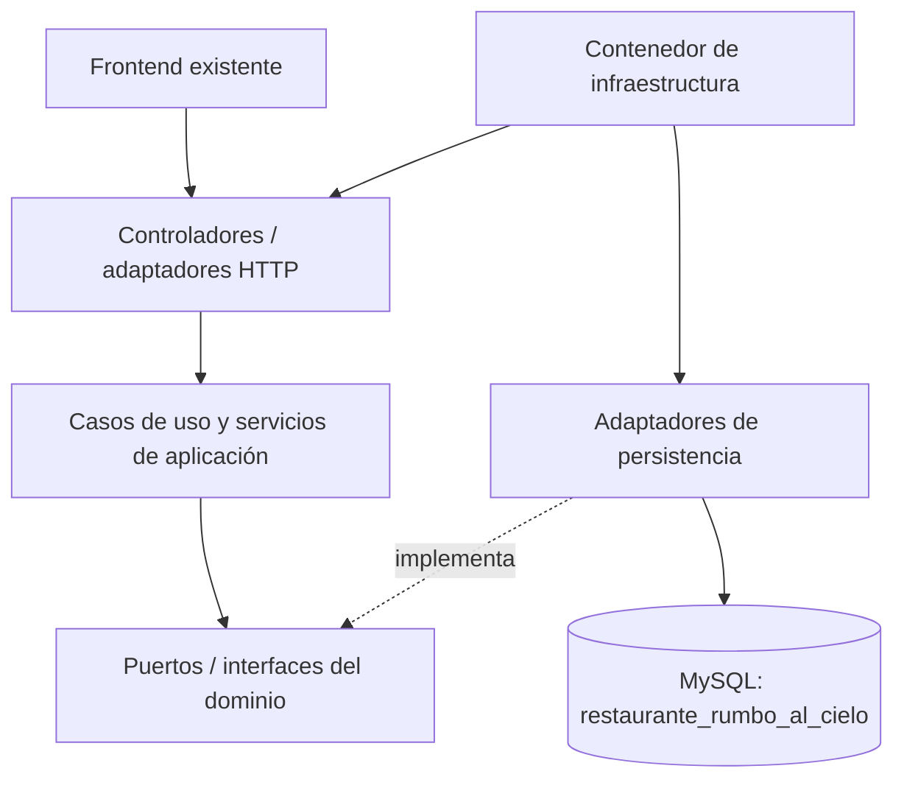

# Arquitectura limpia — Rumbo al Cielo

## Alcance implementado

La aplicación conserva las pantallas, rutas AJAX y la base de datos MySQL existentes. Los siete módulos usan entidades de dominio y flujos de aplicación especializados; no se utiliza un CRUD genérico paralelo para reemplazar las reglas reales del negocio.

## Diagrama



## Capas y carpetas

| Capa | Carpeta | Responsabilidad |
|---|---|---|
| Dominio | `src/Domain/` | Entidades, reglas y contratos/puertos de repositorio. No depende de PDO ni HTTP. |
| Aplicación | `src/Application/` | Reglas de negocio y casos de uso de los módulos. |
| Adaptadores HTTP | `backend/controllers/`, `src/Adapters/Http/` | Reciben solicitudes, aplican el límite HTTP y llaman a casos de uso. Se conservan las firmas de los controladores antiguos para no romper el frontend. |
| Adaptadores de persistencia | `backend/models/`, `src/Adapters/Persistence/` | Implementan los puertos y encapsulan las consultas PDO/MySQL. |
| Infraestructura | `src/Infrastructure/Contenedor.php` | Raíz de composición: crea servicios, repositorios y controladores. |
| Pruebas | `tests/` | Pruebas de dominio y casos de uso con dobles en memoria. |

## Módulos y flujos

| Módulo | Entidad | Caso de uso / servicio principal | Persistencia |
|---|---|---|---|
| Usuarios | `Domain/Usuario/Usuario.php` | `Application/Services/EmpleadoService.php`, `AuthService.php` | `Usuario` mediante `UsuarioRepository` |
| Familiares | `Domain/Familiar/Familiar.php` | `Application/Services/FamiliarService.php` | `Familiar` mediante `FamiliarRepository` |
| Pensiones | `Domain/Pension/Pension.php` | `Application/Pension/GestionarInscripcionPension.php` | `PdoPensionRepository` mediante `PensionRepository` |
| Platos | `Domain/Plato/Plato.php` | Registrar, modificar, activar, desactivar y listar | `PdoPlatoRepository` |
| Menú | `Domain/Menu/Menu.php` | `Application/Services/MenuService.php` y `Application/Menu/PublicarMenuSemanal.php` | `Menu` y `PlatoCatalogo` mediante sus puertos |
| Reservas | `Domain/Reserva/Reserva.php` | `Application/Services/ReservaService.php` | `Reserva`, `Familiar`, `Calendario`, `Usuario`, `Menu` y `Configuracion` mediante puertos |
| Reportes | `Domain/Reporte/Reporte.php` | `Application/Services/ReporteService.php` | `Reporte`, `Calendario` y `Configuracion` mediante puertos |

## Controladores y composición

Los controladores HTTP de Familiares, Empleados/Usuarios, Autenticación, Menú, Reservas y Reportes ya no contienen las reglas de negocio: delegan en servicios de `src/Application/Services/`. El endpoint de pensiones delega en `PensionController` y `GestionarInscripcionPension`. El guardado del menú semanal también utiliza `PublicarMenuSemanal`; sus consultas de catálogo y escritura están encapsuladas en adaptadores de persistencia.

`src/Infrastructure/Contenedor.php` es el punto de composición para construir los servicios y sus dependencias. Los modelos antiguos de `backend/models/` se mantienen como adaptadores compatibles con la estructura de tablas actual y también implementan los contratos definidos en `src/Domain/Ports/`.

La autenticación verifica credenciales en el caso de uso; el controlador HTTP administra la sesión y la redirección. El envío de notificaciones de reserva se ejecuta en el adaptador HTTP y no dentro del caso de uso.

## Base de datos

Se conserva la base `restaurante_rumbo_al_cielo` y el archivo `database/restaurante_rumbo_al_cielo.sql`. No se requiere crear una segunda base ni cambiar nombres de tablas para esta migración. Los adaptadores usan consultas preparadas y los nombres de tablas/columnas se mantienen definidos en el código.

## Verificación

Desde la raíz del proyecto:

```bash
php tests/run_smoke.php
php tests/run_migration_smoke.php
```

Para la suite PHPUnit, instalar dependencias con `composer install` y ejecutar `composer test`.

La revisión automatizada de este paquete comprobó la sintaxis PHP y ejecutó las dos pruebas rápidas. La integración real con MySQL debe confirmarse en el XAMPP local del estudiante, porque el entorno donde se preparó el ZIP no tiene controlador PDO MySQL ni servidor MySQL. No se afirma que se haya ejecutado una prueba real contra la base de datos del usuario.
